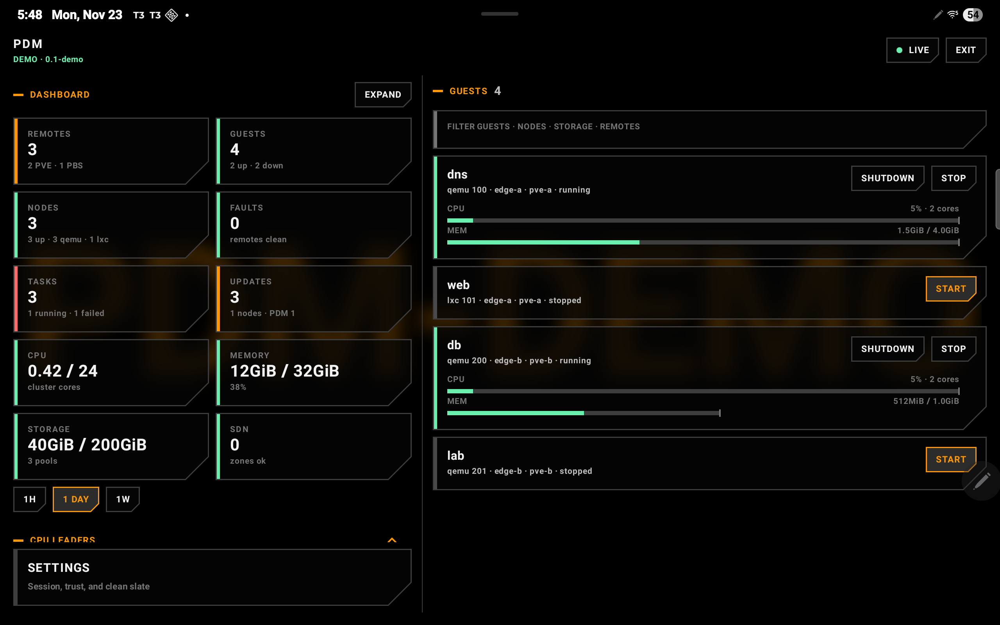
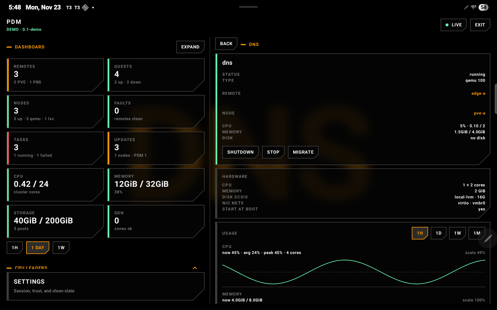
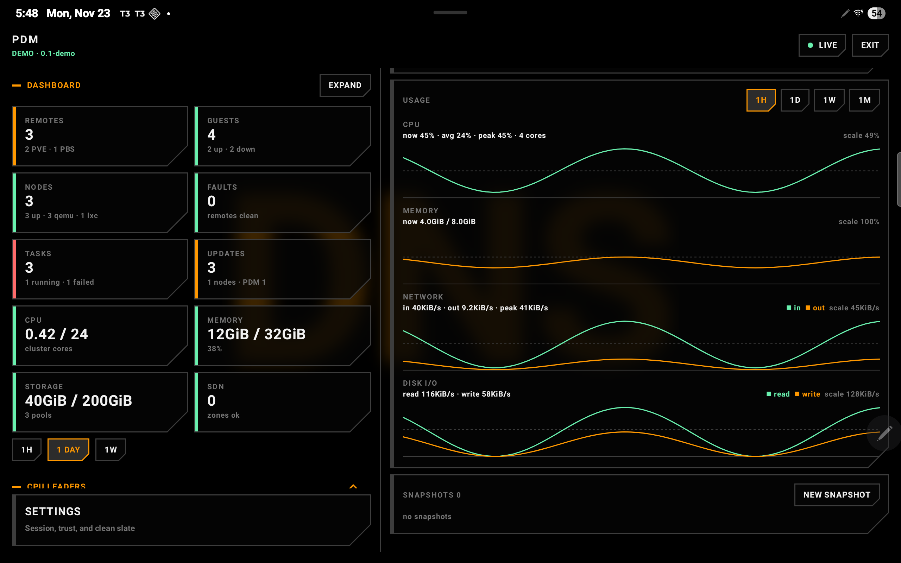
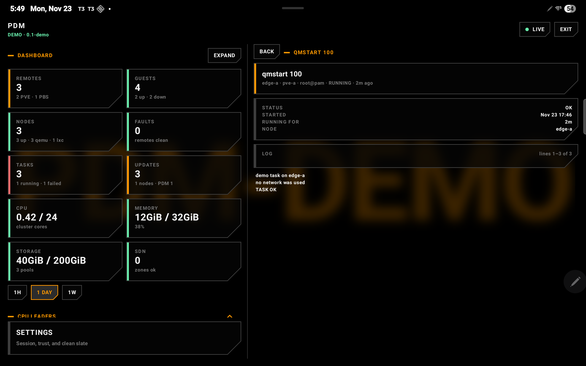
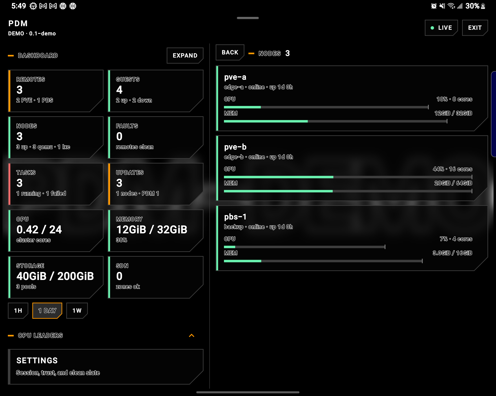
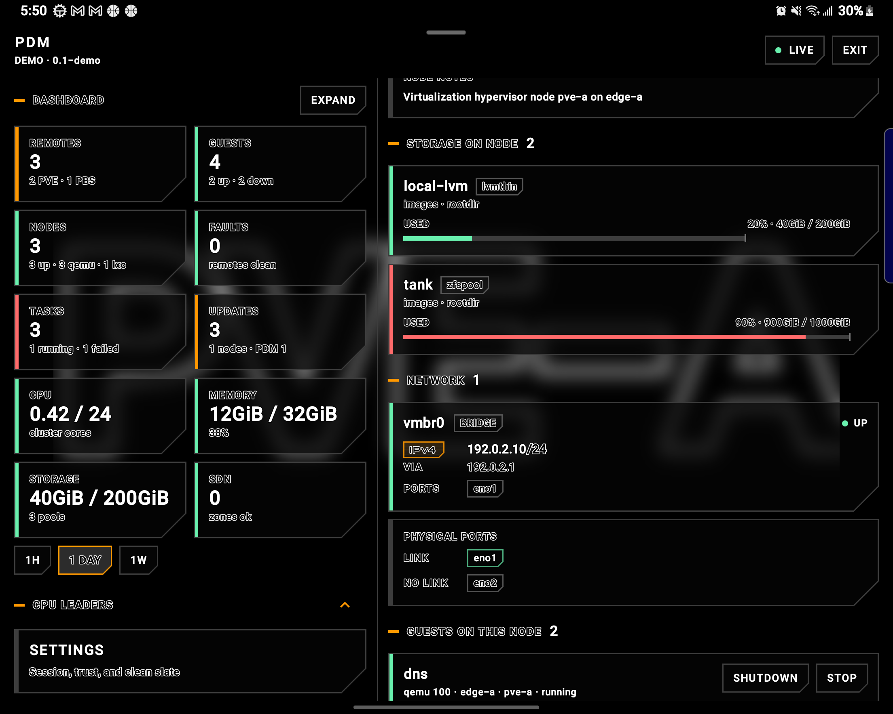
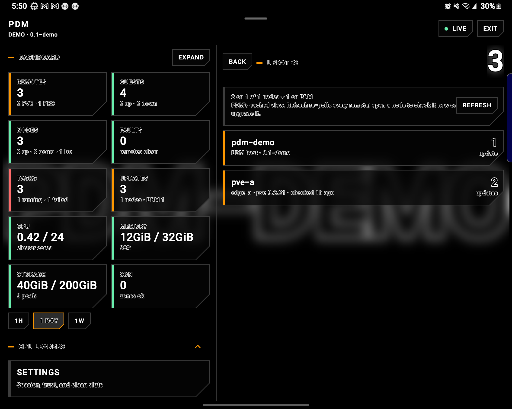
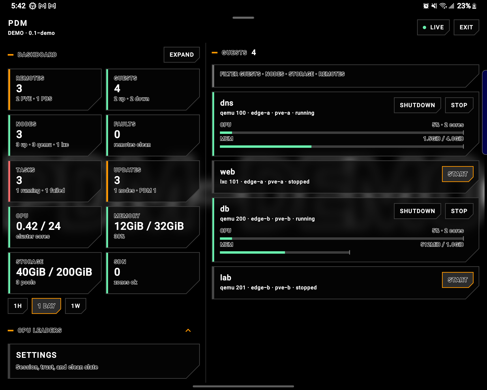
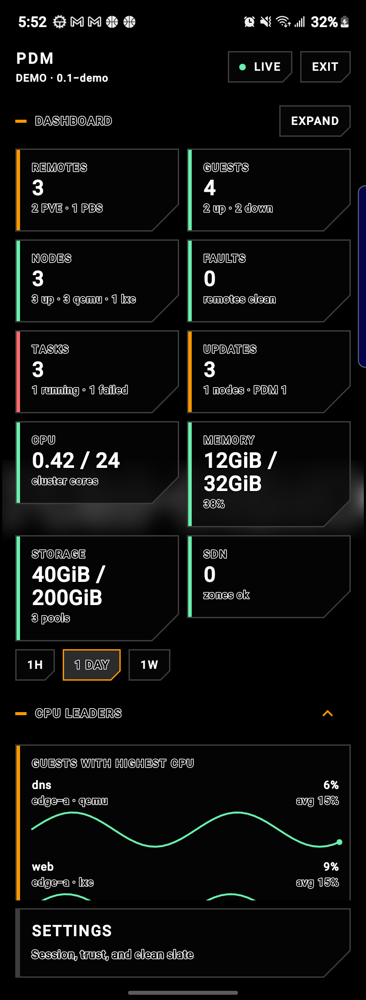

# PdmApp

**Your PDM fleet, built for Android.**

PdmApp is an independent Android client for Proxmox Datacenter Manager. See your fleet at a glance, investigate resource usage, follow tasks, and manage supported guest operations from your phone, foldable, or tablet.

## Highlights

- **Fleet overview:** remotes, virtual machines, containers, nodes, storage, and resource leaders in one dashboard.
- **Guest controls:** start, shut down, stop, and manage supported snapshot and migration workflows, subject to account permissions.
- **Performance history:** CPU, memory, network, and disk activity graphs for supported resources.
- **Task tracking:** follow running and recent tasks, inspect status, and read task logs.
- **Node details:** inspect guest hardware, node storage, networking, and pending package updates.
- **Connection security:** HTTPS certificate verification and pinning, password or API-token sign-in, and supported TOTP challenges.
- **Offline viewing:** revisit previously cached data with an optional encrypted cache; server-changing actions are disabled in offline views.
- **Android layouts:** compact and two-pane views for phones, foldables, and tablets, with a dark, OLED-oriented interface.
- **Node terminals:** interactive terminal access where the server, password session, and account permissions support it.
- **Built-in demo:** explore a synthetic fleet without supplying real server credentials.

Available features depend on the PDM/server version, remote capabilities, and account permissions. See the [store-listing draft](docs/STORE_LISTING.md) for the short and full app descriptions.

## Screenshots

### Fleet overview

<a href="docs/screenshots/fleet-overview.png"></a>

### Guest details

<a href="docs/screenshots/guest-details.png"></a>

### Performance history

<a href="docs/screenshots/performance-history.png"></a>

### More views

<table width="100%">
  <tr><th width="50%">Task log</th><th width="50%">Node status</th></tr>
  <tr>
    <td width="50%" align="center" valign="top"><a href="docs/screenshots/task-log.png"></a></td>
    <td width="50%" align="center" valign="top"><a href="docs/screenshots/node-status.png"></a></td>
  </tr>
  <tr><th width="50%">Storage and networking</th><th width="50%">Pending updates</th></tr>
  <tr>
    <td width="50%" align="center" valign="top"><a href="docs/screenshots/storage-networking.png"></a></td>
    <td width="50%" align="center" valign="top"><a href="docs/screenshots/pending-updates.png"></a></td>
  </tr>
  <tr><th width="50%">Two-pane overview</th><th width="50%">Compact overview</th></tr>
  <tr>
    <td width="50%" align="center" valign="top"><a href="docs/screenshots/wide-overview.png"></a></td>
    <td width="50%" align="center" valign="top"><a href="docs/screenshots/compact-overview.png"></a></td>
  </tr>
</table>

[Open the full-size gallery](docs/screenshots/README.md)

## Build

Install Android Studio and the SDK required by `app/build.gradle.kts`. Set the SDK location through Android Studio or an ignored `local.properties` file. The Gradle daemon toolchain is declared in `gradle/gradle-daemon-jvm.properties`.

On Windows:

```powershell
.\gradlew.bat :app:testDebugUnitTest :app:lintDebug :app:assembleDebug --console=plain
```

On macOS or Linux, use `./gradlew` instead.

The app currently targets Android API 36, compiles against API 37, and supports API 27 and newer. The current `release` build configuration uses the Android debug signing key for development. Configure appropriate release/upload signing before distributing through Google Play; keep all signing material outside Git.

## Ownership and licensing

Except where another license or notice is specified, original PdmApp code and project materials are licensed under the [Apache License, Version 2.0](LICENSE). Copyright 2026 primary-null. See [NOTICE](NOTICE) for attribution and [THIRD_PARTY.md](THIRD_PARTY.md) for separately licensed components. Third-party licenses remain in effect. Dependency/provenance and branding reviews remain outstanding before a public release.

PdmApp is an independent project and is not affiliated with or endorsed by Proxmox Server Solutions GmbH. Proxmox is a registered trademark of Proxmox Server Solutions GmbH.

See [development notes](docs/DEVELOPMENT.md) for build guidance and outstanding release work. See the [publication checklist](docs/PUBLICATION.md) before sharing any repository update or changing visibility.
