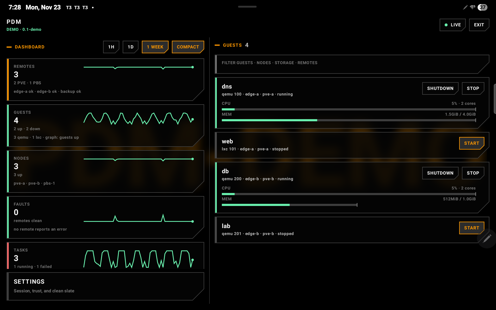
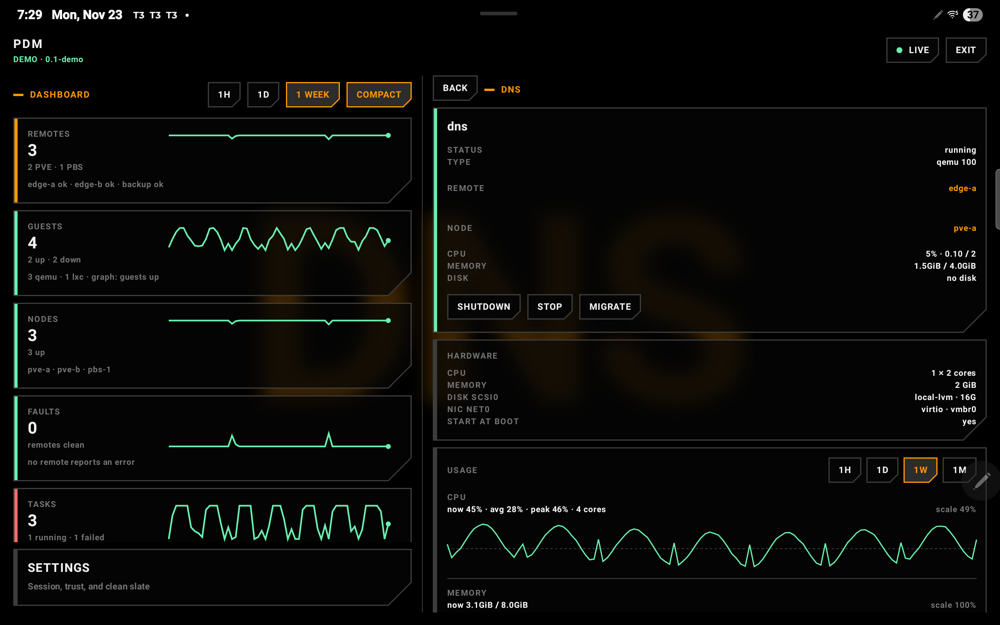
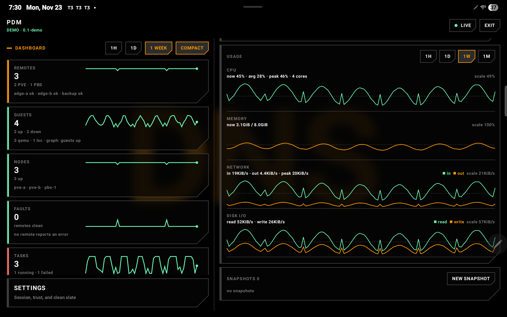
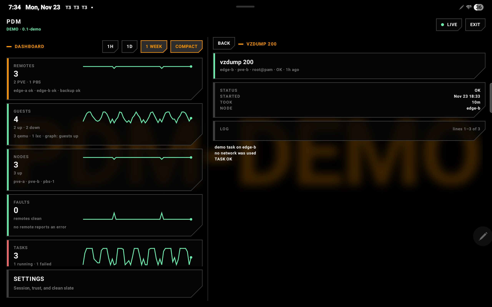
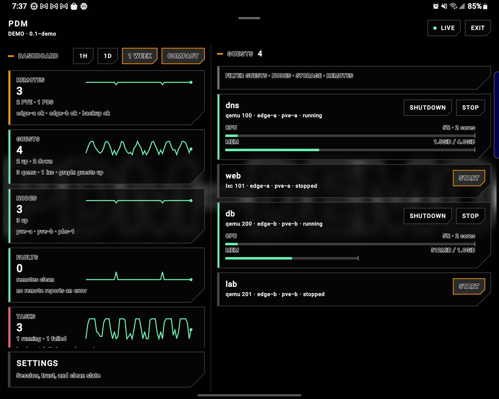
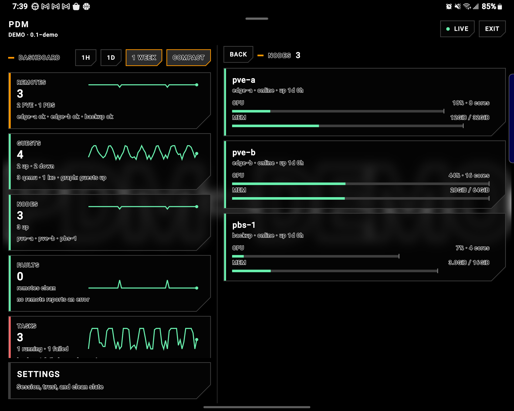
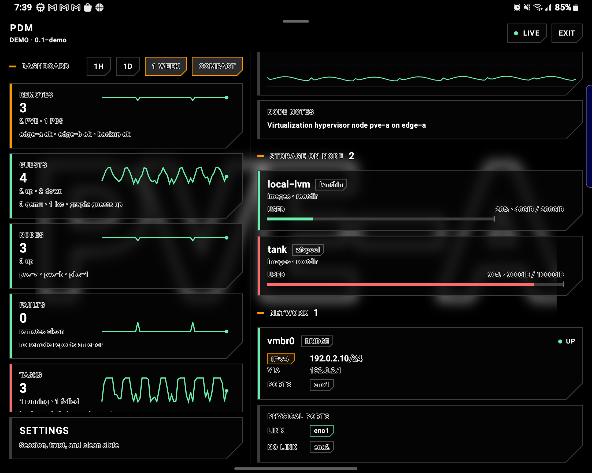
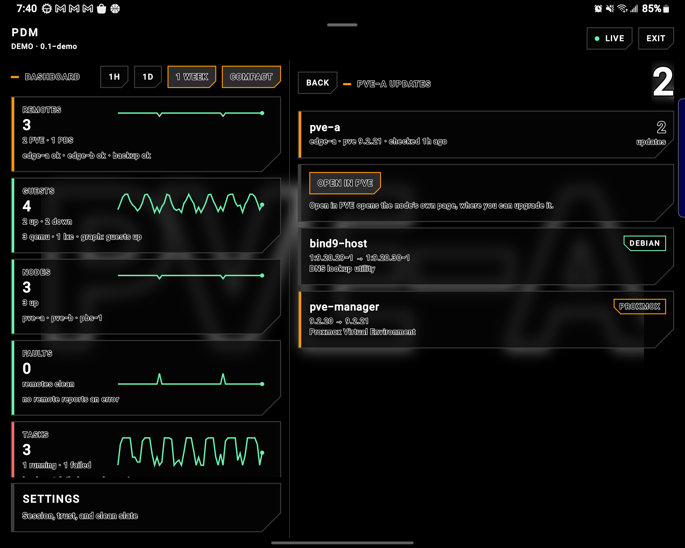
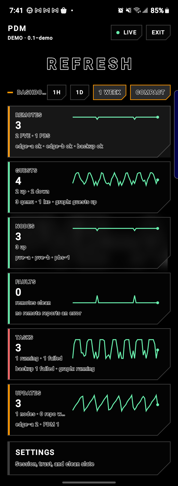

# PdmApp screenshot gallery

Actual screenshots of PdmApp **0.3.31 (22)** using the built-in synthetic demo. The gallery shows compact and wide layouts. Image pixels are unchanged from the original captures.

## Fleet overview

Synthetic remotes, guests, nodes, tasks, updates, and resource summaries.

## Guest details

A synthetic guest with its status, hardware, and supported controls.

## Performance history

CPU, memory, network, and disk I/O charts from synthetic demo data.

## Task status and log

A synthetic task result and log.

## Two-pane fleet overview

The fleet dashboard and guest list arranged side by side.

## Node overview

Synthetic node status and CPU/memory allocations.

## Storage and networking

Synthetic storage pools, bridge configuration, and documentation-range addresses.

## Pending updates

Available package updates for a synthetic node.

## Compact overview

The dashboard in a narrow window.

## Store preparation

Before a Play Store upload, check dimensions, aspect ratios, and file sizes against the [official preview-asset requirements](https://support.google.com/googleplay/android-developer/answer/9866151?hl=en). Do not stretch screenshots to fit.
